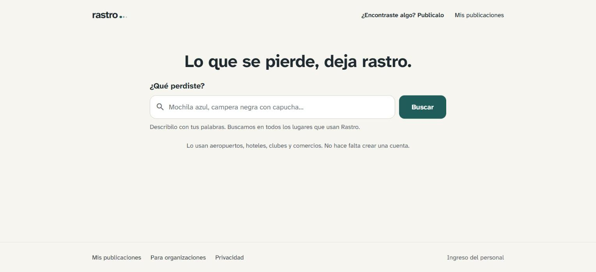
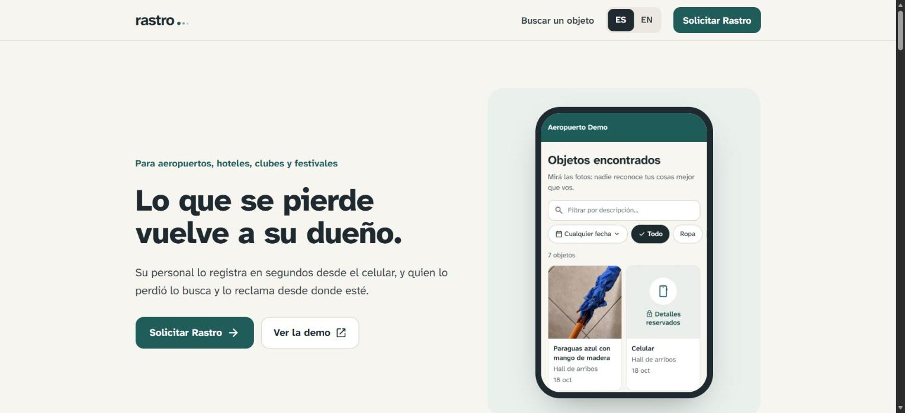

 

---

## 👋 About me

Software Development student at **UNCuyo–ITU** (graduating 2027) who likes building and shipping real products, front to back. I work across the stack — **React + TypeScript** on the front end, **Spring Boot + REST APIs** on the back end, with **SQL Server, MongoDB, PostgreSQL and Docker** on the infrastructure side. Lately I've been building complete products on **Next.js + Supabase**, from the database to the deploy.

🌎 Based in Mendoza, Argentina — **open to remote roles**. Spanish (native) · English (C1).

---

## 🛠️ Tech Stack

**Languages**

**Frontend**

**Backend & Databases**

**Cloud & Tools**

---

## 🚀 Featured Projects

### 🧭 Rastro — Full-Stack · SaaS
Lost-and-found software for organizations (airports, hotels, clubs, festivals). Two apps on one database: a **paid staff panel** (intake, claims, deliveries, reports) and a **free public web** where people search and claim what they lost. An **automatic matching engine** cross-references both sides and suggests matches. Shipped end to end in 14 planned phases, with a verification suite and a commercial landing page.
`Next.js` · `React` · `TypeScript` · `PostgreSQL` · `Supabase` · `Drizzle` · `Tailwind CSS` · `Vercel`
🌐 [Live site](https://rastro-vert.vercel.app) · 🔒 Private repository

  
  

### 🔐 Inventario Seguro — Full-Stack
Secure lab-equipment inventory system built in a 4-person Agile team. REST API with a **dual-database architecture (SQL Server + MongoDB)** and 17 passing unit & integration tests.
`Spring Boot` · `React` · `TypeScript` · `Docker`
🔗 [View repository](https://github.com/juanmahumeniuk/egi-inventario-seguro)

### 🏔️ Francisco Explora — Frontend
Personal website for an adventure content creator. Dark aesthetic, clean UI, optimized performance. **Live in production** on a custom domain.
`Astro` · `Tailwind CSS` · `Vercel`
🌐 [Live site](https://franciscoexplora.com) · 🔗 [Code](https://github.com/IgnacioMorichetti/WEB-Francisco-Explora)

### 🚣 Parador Aventura — Frontend
Single-page website for an adventure-tourism business in Potrerillos, Mendoza. Responsive layouts, dark/light mode, interactive activity modals and Google Maps integration.
`HTML` · `Tailwind CSS` · `JavaScript`
🔗 [View repository](https://github.com/IgnacioMorichetti/parador-aventura)

### 🎙️ Escucha — Desktop tool
Offline voice assistant for Windows that runs in the background: say a program's name to open it (local speech recognition with **Vosk + Whisper**) or clap to launch Spotify. Starts on login.
`Python` · `Vosk` · `faster-whisper`
🔒 Private repository

---

## 📊 GitHub Stats

---

## 📜 Certifications

- **AWS Certified Cloud Foundations Practitioner** — 2025

---

💬 Open to remote software engineering roles — let's build something together.

